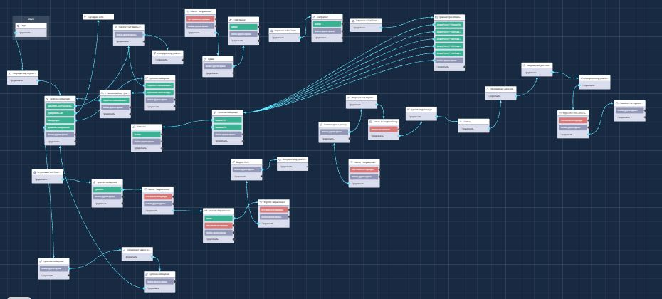
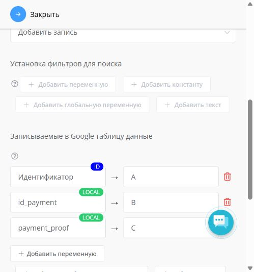
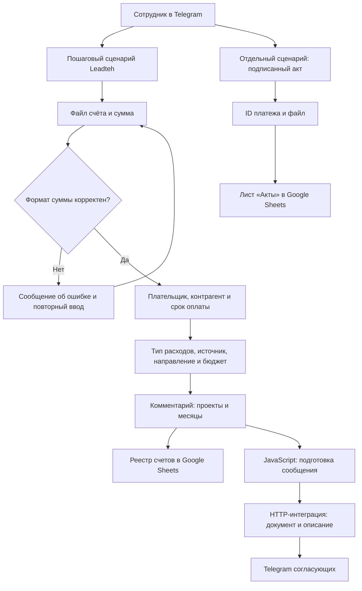

# Согласование счетов в Telegram

### От документа в чате — к структурированной заявке и реестру

`Leadteh` · `Telegram` · `JavaScript` · `HTTP API` · `Google Sheets`

Бот собирает счёт и реквизиты, проверяет формат суммы, помогает указать бюджетный контекст и передаёт документ согласующим. Заявка сохраняется в Google Sheets; подписанные акты собираются отдельным сценарием с привязкой к ID платежа.

*Общий вид главного сценария: сбор данных, ветвления, интеграции и уведомления. Масштаб уменьшен, чтобы показать все блоки и связи. [Открыть изображение](images/00-scenario-overview.jpg).*

| Заявка | Интеграции | Документы |
| :--- | :--- | :--- |
| **14 полей** в реестре | **Google Sheets + HTTP API** | **Счёт и подписанный акт** |
| Реквизиты, срок, бюджет и инициатор | Хранение данных и передача документа | Отдельный сценарий актов с ID платежа |

## Задача

Собрать в одном процессе всё, что нужно для рассмотрения счёта: документ, сумму, стороны платежа, срок и назначение расходов. Сотрудник заполняет заявку в Telegram, согласующие получают документ с описанием, а сведения остаются в общем реестре.

## Путь заявки

**1. Документ и сумма.** Сотрудник запускает сценарий, отправляет счёт и вводит сумму. При неверном формате бот повторяет вопрос.

**2. Реквизиты и срок.** Выбирает плательщика и контрагента, указывает источник и крайний срок оплаты.

**3. Бюджетный контекст.** Указывает тип расходов, выбирает направление через Telegram-опрос, прикладывает подтверждение бюджета и поясняет распределение по месяцам или проектам.

**4. Реестр и уведомление.** Переменные заявки записываются в Google Sheets. JavaScript собирает подпись к документу, HTTP-интеграция передаёт его в Telegram согласующих.

**5. Закрывающий документ.** Через отдельный пункт меню сотрудник отправляет подписанный акт и ID платежа. Данные сохраняются на листе «Акты».

## Что показывает этот проект

| Область | Реализация |
| :--- | :--- |
| Проектирование процесса | Меню, пошаговый ввод, ветвления и отдельный сценарий актов |
| Качество ввода | Регулярное выражение для суммы, сообщение об ошибке и повторный вопрос |
| Работа с данными | Переменные, списки выбора, сопоставление 14 полей с колонками реестра |
| JavaScript | Сборка подписи из переменных, обработка пустых значений, нормализация username |
| Интеграции | Google Sheets и POST-запрос с документом и подписью |
| Пользовательские инструкции | Примеры распределения расходов по проектам и месяцам прямо в диалоге |

## Реализация крупным планом

<strong>Четыре скриншота: валидация, реестр, комментарии и акты</strong>

Снимки из редактора существующего проекта. Они показывают настройки без реальных финансовых документов и контактов сотрудников.

| Проверка суммы | Запись заявки в реестр |
|---|---|
|  |  |
| Принимаются целые значения и дробная часть через запятую. | Поля счёта сопоставляются с колонками таблицы. |

| Распределение расходов | Привязка акта к платежу |
|---|---|
|  |  |
| Встроенные примеры объясняют распределение по месяцам и проектам. | `id_payment` связывает приложенный документ с платежом. |

<strong>Схема движения данных</strong>

Схема обобщает изученные блоки и потоки данных. Решение о согласовании и выполнение платежа остаются за ответственными сотрудниками. Реакции согласующих и обработка статусов на стороне внешнего сервера в рамках этого разбора не проверялись.

## Подробнее

- [Архитектура и HTTP-интеграция](docs/architecture.md)
- [Структура реестра счетов и актов](docs/data-model.md)
- [Обезличенный JavaScript-блок](examples/leadteh-caption.js)
- [Основания и границы проверки](docs/evidence.md)

---

**О кейсе.** Описана конфигурация существующего бота, изученная 23 ноября 2026 года. Это кейс реализации, а не пакет для развёртывания. Полный цикл согласования и обработка статусов внешним сервером при подготовке портфолио не тестировались; экономия времени и объём использования не измерялись. Секреты, рабочие реестры и реальные счета в репозиторий не включены.
