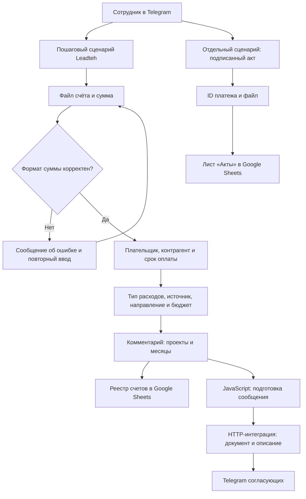
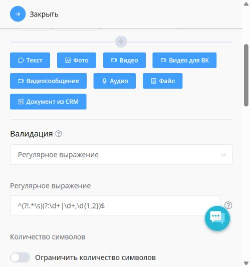
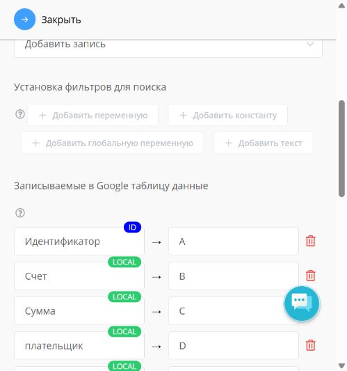
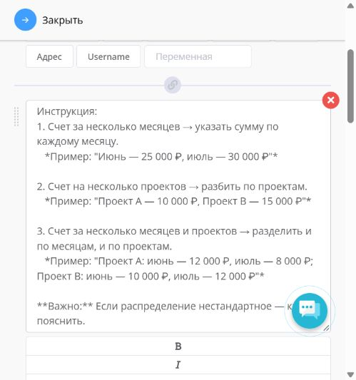

# Telegram-бот для согласования счетов

**Автоматизация подачи счетов на оплату и сбора закрывающих документов: Telegram → Leadteh → Google Sheets.**

Бот последовательно собирает документ, сумму, плательщика, контрагента, срок оплаты и бюджетный контекст. Данные попадают в реестр, а документ с подготовленным описанием передаётся в Telegram через HTTP-интеграцию. Отдельный сценарий принимает подписанный акт и сохраняет его вместе с ID платежа.

Это портфолио существующего проекта: описание и снимки конфигурации Leadteh, изученной 23 ноября 2026 года. Публичная версия содержит обезличенные материалы; полный экспорт рабочего бота и сервер интеграции сюда не включены.

**Стек:** Leadteh · Telegram · JavaScript · HTTP API · Google Sheets.

## Задача

Организовать единый способ подачи счёта на согласование: вместе с файлом получить реквизиты, срок, направление расходов и обоснование бюджета. Сделать эти сведения доступными в табличном реестре и передать согласующим понятное сообщение с документом.

## Что реализовано

- Пошаговый сценарий подачи счёта с меню и пользовательской инструкцией.
- Проверка формата суммы регулярным выражением и повторный вопрос при ошибке.
- Выбор плательщика, контрагента и источника; сбор типа расходов и направления.
- Выбор срока оплаты из пяти дат либо ввод вручную согласно инструкции.
- Выбор направления через Telegram-опрос: в схеме предусмотрены `sendPoll` и `stopPoll`.
- Сбор подтверждения бюджета и комментариев с распределением расходов по проектам и месяцам.
- Запись 14 полей заявки в Google Sheets.
- Подготовка текста сообщения в JavaScript и передача документа через HTTP POST.
- Отдельный сценарий загрузки подписанного акта: ID платежа и файл записываются на лист «Акты».

## Как устроен процесс

Схема обобщает изученные блоки и потоки данных. Решение о согласовании и выполнение платежа остаются за ответственными сотрудниками. Реакции согласующих и обработка статусов на стороне внешнего сервера в рамках этого разбора не проверялись.

## Скриншоты реализации

Снимки сделаны в редакторе реального проекта. Показаны настройки, а не переписка с пользователями или реальные финансовые документы.

| Проверка суммы | Запись заявки в реестр |
|---|---|
|  |  |
| Принимаются целые значения и дробная часть через запятую. | Поля счёта сопоставляются с колонками таблицы. |

| Распределение расходов | Привязка акта к платежу |
|---|---|
|  |  |
| Встроенные примеры объясняют распределение по месяцам и проектам. | `id_payment` связывает приложенный документ с платежом. |

## Технические решения

**Валидация суммы.** В блоке используется выражение `^(?!.*\s)(?:\d+|\d+,\d{1,2})$`: допускаются, например, `1000` и `1000,50`; пробелы и десятичная точка не принимаются. Это проверка формата: положительность суммы и бюджетный лимит этим выражением не проверяются.

**Структурированные данные.** Каждый ответ сохраняется в переменную. В реестре отдельно представлены счёт, сумма, стороны платежа, срок, направление, бюджетный контекст, инициатор и комментарий. [Сопоставление полей](docs/data-model.md).

**Подготовка сообщения.** JavaScript собирает подпись из переменных, обрабатывает отсутствующие значения и нормализует username. [Обезличенный пример блока](examples/leadteh-caption.js) показывает эту логику; имена получателей заменены демонстрационными.

**Передача документа.** HTTP-блок использует POST и `multipart/form-data` с полями `chat_id`, `caption`, `parse_mode` и `document`. Адрес сервера и параметры доступа не опубликованы.

**Закрывающие документы.** Для акта используется отдельная ветка, запрос файла и запись на отдельный лист. Это позволяет хранить связь документа с ID платежа без повторного ввода всей заявки.

## Результат и границы проверки

В конфигурации реализован единый маршрут сбора заявки, передачи документа согласующим и регистрации данных, а также отдельный маршрут актов. Этот кейс показывает проектирование диалога, работу с переменными и справочниками, валидацию, JavaScript и интеграцию с Google Sheets и HTTP API.

При подготовке портфолио выполнен осмотр настроек без отправки тестовых счетов и изменения рабочего сценария. Полный цикл согласования, доставка сообщений, состояние внешнего сервера и успешная запись новых строк в этом сеансе не проверялись. Количество обработанных счетов, сокращение ошибок и экономия времени не измерялись и не заявляются.

В проекте также есть сценарий с названием «Договоры», но отдельный завершённый процесс договоров в этот кейс не включён.

## Материалы

- [Архитектура и границы компонентов](docs/architecture.md)
- [Структура реестра](docs/data-model.md)
- [Что подтверждено при осмотре](docs/evidence.md)
- [Обезличенный JavaScript](examples/leadteh-caption.js)
- [Скриншоты](images/)

Для воспроизведения потребуется свой проект Leadteh, Telegram-бот, таблица, справочники и серверная HTTP-интеграция. Репозиторий является кейсом реализации, а не готовым пакетом развёртывания.
